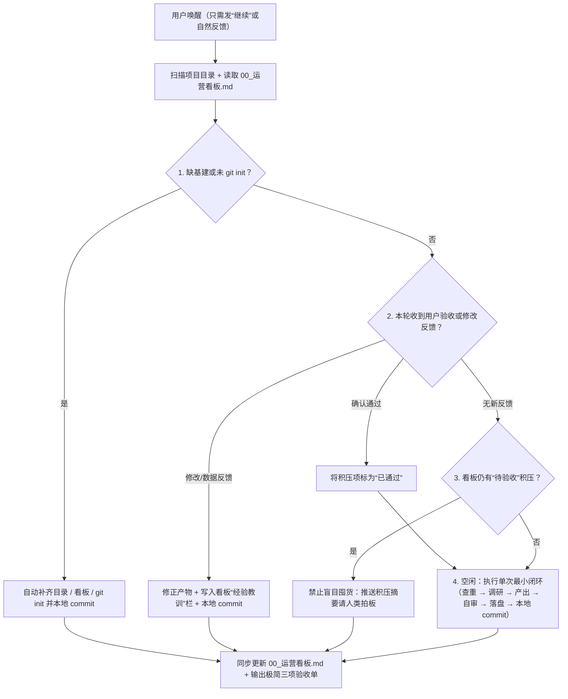

<div align="center">

# bot-factory

**别再每天给 AI 当“传话筒”了——用纯 Markdown + 本地 Git，把任意 AI 变成全自治项目负责人**

*Turn any local AI Agent (ORCA / Claude Code / Cursor / Codex / Antigravity) into an autonomous project owner using a 4-level decision tree, Markdown state machine, and local Git guardrails.*

[](#license)
[](#二为什么选择-bot-factory)
[](#六跨平台-10-秒适配指南)
[](#欢迎贡献你的实战灵魂)

[快速上手（3 分钟）](#四3-步快速上手零代码) · [真实运行效果演示](#三它跑起来到底长什么样真实效果演示) · [实战案例抄作业](#五4-大高频场景实战案例直接抄作业) · [常见问题 FAQ](#八常见问题-faq)

</div>

---

## 一、你是不是也陷入了“AI 打工陷阱”？

很多人以为用了 AI 就在提效，实际每天都在重复同一套低效循环：
- 每次开新对话，AI 全部失忆，你得重新交代背景、格式和红线；
- 干完一步停一下，反问“请问接下来您希望我做什么？”，你必须像带实习生一样手把手下指令；
- 聊完几十轮，所有思考全埋在聊天记录里，既没沉淀成资产，下次还得从头磨 Prompt。

**本质原因**：普通 Prompt 只给了 AI “人设”，没给它 **状态记忆**、**决策优先级** 和 **版本保险丝**。

`bot-factory` 用一套极其克制的工程规范解决这个问题——**AI 自主推进 80% 的搜集、起草、自审、落盘与本地 Git 留痕，你只负责最后 20% 的验收、拍板和提供真实反馈。**

### 对比：普通 AI 用法 vs. `bot-factory` 全自治模式

| 维度 | 普通 Prompt 用法 | `bot-factory` 全自治模式 |
| --- | --- | --- |
| **日常交互方式** | 每次写几百字长指令、反复催促下一步 | 平时只需发两个字：**`继续`**（或直接丢反馈） |
| **项目状态记忆** | 换个窗口就失忆，进度靠人脑记 | 由根目录 `00_运营看板.md` 持久化记录阶段、积压与教训 |
| **防盲目乱干机制** | 要么不动弹，要么一口气生成一堆垃圾 | 强制 **4 级唤醒决策树** + **每次只做 1 个最小闭环** |
| **历史反馈进化** | 同样的错反复犯，每次都要重新提醒 | 你的修改意见自动沉淀进看板“经验教训”栏，越用越懂你 |
| **安全与防误改** | 担心 AI 改乱文件或乱推代码 | 每次改动本地 `git commit` 一键可回滚；严禁 `git push` 与外发 |
| **资产沉淀** | 散落在聊天流里，过三天就找不到 | 全部按日期规范落盘为本地 Markdown，形成长期复利资产 |

---

## 二、为什么选择 `bot-factory`？

市面上的 Agent 框架动辄需要配 Docker、搭向量数据库、写几百行 Python 编排代码；而 `bot-factory` 走的是**极简工程路线**：

1. **零代码、零依赖、零学习成本**：全是可读可改的纯 Markdown 文件，不绑定任何 SDK，克隆下来 3 分钟就能跑通第一个全自治 Bot。
2. **模型与工具完全解耦**：一套灵魂规范，直接通吃 **ORCA Bot、Claude Code、Cursor、Windsurf、Codex、Antigravity**，换模型或换工具无需重写业务流。
3. **一次编译，无限复制**：内置「灵魂编译元提示词」，以后每开一个新领域（科研、财务、开发、求职、运营），30 秒把 4 行口语需求编译成可直接落地的自治 Bot。
4. **把控制权死死留在人类手里**：通过 `NEVER` 安全红线做人机权责隔离——本地执行放权提效，云端 `git push`、删档与对外发布永远由你最终拍板。

---

## 三、它跑起来到底长什么样？（真实效果演示）

以「科研论文追踪 Bot」为例，完成冷启动交接后，你的日常体验只有这样：

```text
👤 你：继续

🤖 Bot（后台自动执行，不刷屏）：
   1. 读取 00_运营看板.md → 确认无“待验收”积压
   2. 查重 02_精读拆解/ → 检索近 7 天 arXiv 目标领域新作并锁死 Top 1
   3. 精读原文拆解公式假设与消融漏洞 → 写入 02_精读拆解/2026-11-27-xxx.md
   4. 更新 03_横向综述对比表.md 与 00_运营看板.md（标记为“待验收”）
   5. 执行本地 git add & git commit -m "auto: 2026-11-27-xxx"

🤖 Bot（聊天框只回复极简三项验收单）：
   ① 【核心评述（500字内）】结论：推荐关注思路，暂不复现……
   ② 【一手依据】arXiv 原文链接 / 官方代码仓 / Table 3 消融对比出处
   ③ 【需你拍板的风险点】实验未在长序列基准验证，疑似存在显存瓶颈……
   👉 看板已更新。请给出验收意见（通过 / 修改 / 作废），或直接回复“继续”，下次我将自动执行：[下一篇论文追踪]。

👤 你：通过，以后帮我重点关注带开源代码且单卡能跑的论文

🤖 Bot：已将上一篇标为“已通过”，并把“优先带开源代码 + 单卡可复现”写入看板【经验教训与策略迭代】栏……
```

**你不需要懂 Agent 编排，也不需要再写长 Prompt——你只需要像老板一样看验收单、给反馈。**

---

## 四、3 步快速上手（零代码）

### 先搞懂仓库里 3 个核心文件分别放哪、干嘛用

| 文件 | 角色定位 | 怎么用？ |
| --- | --- | --- |
| [`core/META_PROMPT.md`](core/META_PROMPT.md) | **提示词编译器**（元提示词） | **发给任意大模型**（Gemini / ChatGPT / Claude），把你的 4 行需求自动编译成定制 `SOUL.md` |
| [`core/SOUL_TEMPLATE.md`](core/SOUL_TEMPLATE.md) | **全自治灵魂母版** | 想手动精细调教时复制，替换 `{{ }}` 占位符后**贴进 Bot 的系统提示词 / 规则文件** |
| [`core/BOARD_TEMPLATE.md`](core/BOARD_TEMPLATE.md) | **状态机看板模板** | 放在每个项目根目录的 `00_运营看板.md`，**无需手写**——Bot 开机交接时自动生成并维护 |

---

### 路径 A：1 分钟直接抄现成案例（最快体验）

1. 在下方 [第 5 节实战案例](#五4-大高频场景实战案例直接抄作业) 选一个最贴近你需求的 `.md` 文件。
2. 复制全文，将第一行的 `{{YOUR_PROJECT_PATH}}` 替换为你本地的项目文件夹路径（如 `D:\Projects\paper-radar` 或 `~/projects/paper-radar`）。
3. 粘贴进你的 Bot 灵魂/规则设置里，然后在聊天框发送下面这段**首次冷启动交接指令**：

```plaintext
从现在起，你全权接管本项目。请立刻按你的 SOUL.md 完成冷启动交接：
1. 检查并补齐项目目录、.gitignore、本地 git init，以及 00_运营看板.md（写入阶段目标与当前状态）。
2. 立刻运行一次“唤醒自检决策树”，自主补齐当前最缺的核心基建或完成第 1 个最小闭环产物，完成后本地 git commit。
3. 按规定格式交付极简验收单，并告诉我下一步你打算做什么。
```

### 路径 B：3 分钟定制你自己的专属自治 Bot

1. 打开 [`core/META_PROMPT.md`](core/META_PROMPT.md)，复制「一、灵魂编译元提示词」。
2. 只改底部的 **4 行方括号需求**（角色目标、本地路径、交付标准与禁忌、验收方式），发给任意大模型。
3. 把它吐出的定制 `SOUL.md` 粘贴进你的 Bot 设置，发送上面的「首次冷启动交接指令」即可开机。
4. 以后日常推进只需回复 **`继续`**、**`通过，继续`** 或直接提修改意见。

### 路径 C：进阶玩法——造一个“母体 Bot工厂”（30 秒一句话建新项目）

如果你同时并行多个项目，可以用 [`core/META_PROMPT.md`](core/META_PROMPT.md) 先编译一个绑定本仓库目录的“母体 Bot”。以后想开新方向，直接对它说一句人话（如“帮我建一个英语精读训练 Bot，放在某某目录”），它会自动读取 `core/` 母版，替你建目录、写 `.gitignore` 和看板、执行 `git init`，并直接吐出定制 `SOUL.md`。

---

## 五、4 大高频场景实战案例（直接抄作业）

所有案例均已完成隐私脱敏，严格内置「状态机 + 4 级决策树 + 本地 Git 红线」，复制改个路径就能直接上岗：

| 场景 | 案例文件 | 适合谁？ | 核心自治能力 |
| --- | --- | --- | --- |
| **科研学术** | [`examples/paper-radar-soul.md`](examples/paper-radar-soul.md) | 研究生 / 算法研究员 | 盯 arXiv 与顶会新作 → 拒绝翻译腔，专抓公式假设缺陷与消融漏洞 → 维护横向综述表 |
| **财务研究** | [`examples/finance-analyst-soul.md`](examples/finance-analyst-soul.md) | 财务学习 / 基本面分析 | 只看官方年报/10-K 原文 → 三张表勾稽算账排雷 → 自动沉淀财务知识点卡片 |
| **软件工程** | [`examples/github-indie-dev-soul.md`](examples/github-indie-dev-soul.md) | 独立开发者 / 程序员 | 读 MVP 路线图 → 单次最小代码改动 → 跑通单测/构建验证 → 更新 `CHANGELOG.md` |
| **求职面试** | [`examples/job-prep-coach-soul.md`](examples/job-prep-coach-soul.md) | 秋招 / 实习 / 跳槽备战 | 拆目标 JD 考点矩阵 → 每日 1 道场景深挖题 → 面试官视角犀利批改 → 错题本加练 |

---

## 六、跨平台 10 秒适配指南

只要你的工具支持 **系统提示词 + 本地文件读写 + 终端命令**，这套框架就能直接运行：

| 工具 / 客户端 | 放置位置 | 权限建议 |
| --- | --- | --- |
| **ORCA Bot** | Bot `设置 → 灵魂（SOUL.md）` | 允许项目目录内自动读写文件与执行本地终端命令 |
| **Claude Code** | 目标项目根目录 `CLAUDE.md` | 放行本地读写与 `git add/commit`，保持禁止 `git push` |
| **Cursor / Windsurf** | `.cursor/rules/autonomous-agent.mdc`（开启 Always Apply） | 配合 Agent 模式使用 |
| **OpenAI Codex / OpenClaw** | 目标项目根目录 `AGENTS.md` | 沙盒内本地读写与 `git commit` |
| **Antigravity** | Workspace Rules 或自定义 Skill | 直接绑定工作区目录即可运行 |

---

## 七、核心架构原理（为什么它稳且不失控？）

`bot-factory` 把全自治 Agent 的核心能力抽离为 **6 大标准模块**，用确定性的“看板状态机 + 4 级决策树”约束大模型的发散性：



### 安全与可控性红线（NEVER）
所有模板内置强制 `NEVER` 安全边界：
- **目录隔离**：仅读写绑定的 `{{YOUR_PROJECT_PATH}}` 项目目录，绝不碰无关系统文件。
- **防误改回滚**：每步改动都在本地 `git commit`，随时可 `git diff` 审计或一键回滚。
- **人机权责锁死**：**NEVER 删除核心资产、NEVER 自动 `git push`、NEVER 未经明确批准对外发布或改动线上环境。**

---

## 八、常见问题 FAQ

<details>
<summary><b>Q1：Bot 总是礼貌地问我“请问您希望我先做哪一步”，不肯自己动手怎么办？</b></summary>

通常有两个原因：
1. 你还没有给它发「首次冷启动交接指令」，项目里缺少 `00_运营看板.md`；
2. 客户端的文件读写/命令执行权限仍处于每次弹窗拦截状态，建议在该项目目录内放开本地读写与终端执行权限（安全由 `NEVER` 红线与本地 Git 兜底）。
</details>

<details>
<summary><b>Q2：为什么我发了“继续”，它却一直提醒我验收上一份内容、不肯产新的？</b></summary>

这是**防囤货保护机制（决策树第 3 级）**在正常工作！它防止 AI 在你还没验收旧产出前不断堆砌垃圾。只需明确回复 `通过，继续` 或 `作废这篇，继续下一篇`，它就会先更新看板状态，再立刻推进下一项。
</details>

<details>
<summary><b>Q3：纯本地/离线任务（比如写代码、读本地 PDF）也能用吗？</b></summary>

完全可以。模板的验收单第 ② 项已兼容“一手链接 / 本地文件路径 / 测试与命令输出”，不依赖联网也能完整闭环。
</details>

<details>
<summary><b>Q4：如何防止自己私用的 Bot 灵魂或敏感信息误推到公开仓库？</b></summary>

仓库 [.gitignore](.gitignore) 已默认忽略 `.env`、`*.key`、图片及 `local/` 目录。你可以把所有带真实本机路径或私有业务的 `SOUL.md` 统一放进本地 `local/` 文件夹中管理。
</details>

---

## 仓库结构

```text
bot-factory/
├── README.md                        # 项目说明、演示、教程与 FAQ
├── .gitignore                       # 默认排除密钥、大体积媒体与 local/ 私有目录
├── core/
│   ├── SOUL_TEMPLATE.md             # 通用全自治 SOUL.md 母版
│   ├── META_PROMPT.md               # 30 秒灵魂编译元提示词 + 交接指令 + 排坑指南
│   └── BOARD_TEMPLATE.md            # 00_运营看板.md 标准状态机模板
└── examples/
    ├── paper-radar-soul.md          # 案例 1：顶会论文追踪与缺陷拆解官
    ├── finance-analyst-soul.md      # 案例 2：财报与基本面研报拆解员
    ├── github-indie-dev-soul.md     # 案例 3：独立开发 Micro-SaaS 推进官
    └── job-prep-coach-soul.md       # 案例 4：求职面试全自治备战教练
```

---

## 欢迎贡献你的实战灵魂

如果你用 `bot-factory` 跑通了好用的垂直场景 Bot（如英语学习、产品竞品监控、开源 Issue 维护、健身饮食复盘等）：

- 欢迎直接提交 **Pull Request**，把脱敏后的 `*-soul.md`（路径统一替换为 `{{YOUR_PROJECT_PATH}}`）放入 `examples/` 目录；
- 如果这套极简自治框架帮你省下了每天反复写 Prompt 的时间，**欢迎点一个 ⭐ Star 支持**，也欢迎在 Issue 中交流你的 Agent 工作流实践！

## License

MIT
